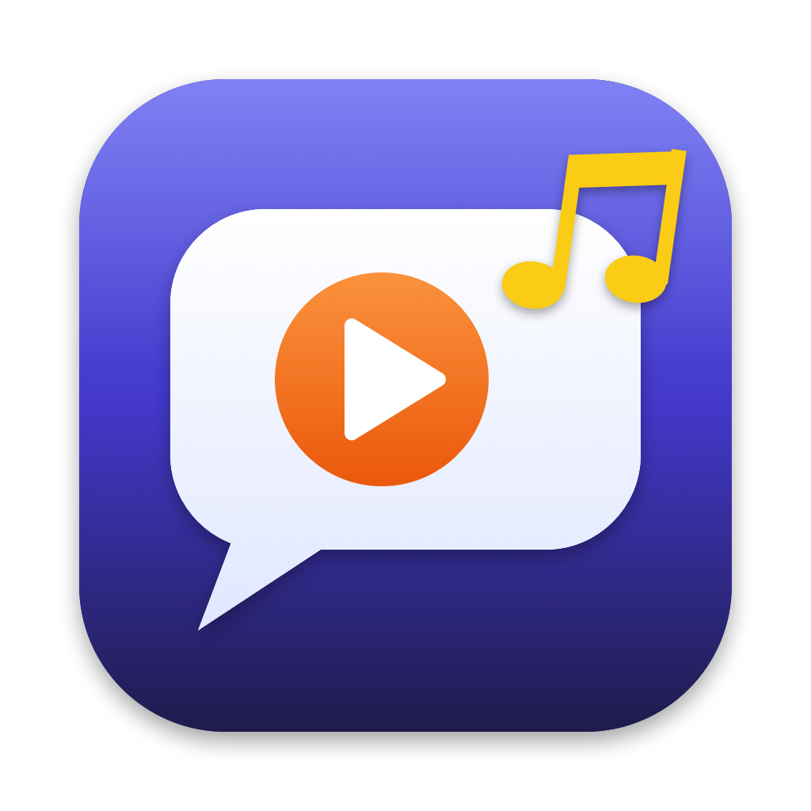

<p align="center">
  
</p>

<h1 align="center">English with Movies & Music</h1>

<p align="center">
  Aprenda inglês com os seus filmes e músicas favoritos.<br>
  Legenda em tempo real · dicionário com um clique · tradução · nota de pronúncia · revisão com cartões
</p>

<p align="center">
  <a href="https://github.com/titanlancsak/english-with-movies-and-music/releases/latest/download/EnglishWithMovies-macOS.zip"><b>⬇️ Baixar para Mac</b></a>
  &nbsp;·&nbsp;
  <a href="https://github.com/titanlancsak/english-with-movies-and-music/releases/latest/download/EnglishWithMovies-Windows.zip"><b>⬇️ Baixar para Windows</b></a>
  &nbsp;·&nbsp;
  <a href="https://github.com/titanlancsak/english-with-movies-and-music/releases">Todas as versões</a>
</p>

---

## O que é

Você abre um filme, uma série ou uma música em inglês, e o app:

1. **transcreve tudo o que é falado** usando inteligência artificial no seu próprio computador ou celular (grátis e sem enviar o áudio para lugar nenhum);
2. mostra a **legenda embaixo do vídeo**, com a fala atual em **negrito** e a palavra dita no momento destacada;
3. deixa você **clicar (ou tocar) em qualquer palavra** para ver o significado, a pronúncia, a tradução e até **3 exemplos de frases**;
4. ajuda você a **guardar e revisar** as palavras novas e a **treinar a pronúncia** repetindo as falas dos personagens no microfone.

Tudo é gratuito: o app e todas as ferramentas que ele usa são de código aberto.

## Funcionalidades

| | Mac | Windows | Android (em teste) |
|---|:---:|:---:|:---:|
| 🎬 **Biblioteca estilo Netflix**: capas, "Continuar assistindo", filmes e músicas | ✅ | ✅ | ✅ |
| ⏯️ **Continua de onde você parou** | ✅ | ✅ | ✅ |
| 📝 **Transcrição automática** das falas com o tempo de cada palavra (Whisper, offline) | ✅ | ✅ | ✅ |
| 🔤 **Legenda em tempo real**: fala atual em negrito e palavra atual destacada | ✅ | ✅ | ✅ |
| ⏩ A legenda **acompanha quando você avança ou volta** o vídeo | ✅ | ✅ | ✅ |
| 📖 **Clique na palavra**: significado, pronúncia e até 3 exemplos | ✅ | ✅ | ✅ |
| 🇧🇷 **Tradução para o português** da palavra e da frase | ✅ (offline) | ✅ (online) | ✅ (online) |
| 📥 **Baixar vídeos do YouTube** colando o link | ✅ | ✅ | — ¹ |
| 🔇 Remove descrições de som como `[Music]`, `(background music playing)`, `♪` | ✅ | ✅ | ✅ |
| 📄 Importa legendas `.srt` (pula a transcrição) | ✅ | ✅ | ✅ |
| 🔖 **Palavras salvas** com a frase do filme, busca e exportação **CSV para o Anki** | ✅ | ✅ | ✅ |
| 🃏 **Revisão com cartões** e repetição espaçada (como o Anki), 3 modos | ✅ | ✅ | ✅ |
| 🎤 **Treino de pronúncia**: repita a fala do personagem e receba uma **nota de 0 a 100** | ✅ | ✅ | ✅ |
| 📊 **Histórico de notas** por fala, com a evolução | ✅ | ✅ | ✅ |
| 👄 **Análise som a som** (fonemas): mostra qual som saiu errado, como o "th" | ✅ (opcional) | ✅ (opcional) | — ² |

¹ As lojas de aplicativos não permitem apps que baixam vídeos do YouTube. No celular, use arquivos que já estão no aparelho.
² Ainda não disponível no celular.

### Como é a nota de pronúncia

Você ouve o personagem, grava a mesma frase e o app compara palavra por palavra:

- **Precisão (60%)**: palavras reconhecidas corretamente, considerando o quanto a IA teve certeza;
- **Fluência (25%)**: sua velocidade comparada à do personagem e pausas longas;
- **Completude (15%)**: se você falou a frase inteira.

Cada palavra aparece em verde (correta), amarelo (pouco clara), vermelho (errada) ou cinza (faltou), com dicas em português. A **análise som a som** opcional mostra também o fonema errado, por exemplo: *“think”: você disse /t/ no lugar de /θ/. Ponha a ponta da língua entre os dentes…*

### Como funciona a revisão

As palavras salvas viram cartões. Você responde **Errei**, **Difícil**, **Bom** ou **Fácil**, e o app agenda a próxima revisão: quem você erra volta em 10 minutos; quem você acerta volta em 1, 3, 8 dias… (algoritmo SM-2, o mesmo do Anki). Modos: Inglês → Português, Português → Inglês e Ouvir.

---

## Download e instalação

### 🍎 Mac

Requisitos: macOS 14 (Sonoma) ou mais novo · Apple Silicon (M1/M2/M3…) ou Intel.

1. Baixe **[EnglishWithMovies-macOS.zip](https://github.com/titanlancsak/english-with-movies-and-music/releases/latest/download/EnglishWithMovies-macOS.zip)** e abra o arquivo para extrair o app.
2. Arraste **English with Movies** para a pasta **Aplicativos**.
3. Instale as ferramentas gratuitas que o app usa, com o [Homebrew](https://brew.sh) (no Terminal):
   ```sh
   brew install ffmpeg whisper-cpp yt-dlp
   ```
   Para a análise som a som (opcional), instale também `brew install espeak-ng uv`.
4. **Na primeira vez**, o macOS avisa que o app é de um desenvolvedor não identificado (ele é gratuito e não tem a assinatura paga da Apple). Clique com o botão direito no app › **Abrir** › **Abrir**. Se não aparecer a opção, vá em **Ajustes do Sistema › Privacidade e Segurança** e clique em **Abrir Mesmo Assim**.

### 🪟 Windows

Requisitos: Windows 10 ou 11 (64 bits). Não precisa instalar mais nada: as ferramentas e o modelo de transcrição já vêm junto (por isso o download tem uns 280 MB).

1. Baixe **[EnglishWithMovies-Windows.zip](https://github.com/titanlancsak/english-with-movies-and-music/releases/latest/download/EnglishWithMovies-Windows.zip)**.
2. Clique com o botão direito no arquivo › **Extrair tudo…** e escolha uma pasta (por exemplo, Documentos).
3. Abra a pasta extraída e dê dois cliques em **english_with_movies.exe**.
4. **Na primeira vez**, o Windows pode mostrar *“O Windows protegeu o computador”* (o app não tem um certificado pago). Clique em **Mais informações › Executar assim mesmo**.

### 🤖 Android (em teste)

A versão Android já está pronta no código e foi testada num emulador, mas **ainda não está disponível para download**: falta testar num celular de verdade. O andamento está na [issue #1](https://github.com/titanlancsak/english-with-movies-and-music/issues/1).

Como vai funcionar: Android 7 ou mais novo, celular de 64 bits, app de uns 20 MB instalado pelo arquivo `.apk` (fora da Play Store). Você escolhe um filme ou música que está no celular, e a transcrição roda no próprio aparelho (um filme de 2 horas deve levar de 20 a 40 minutos num celular recente; com uma legenda `.srt` não é preciso esperar).

### Primeiro uso (Mac e Windows)

- Arraste um filme ou música para a janela, clique em **Escolher arquivo…** ou em **Baixar do YouTube…**.
- No Mac, a primeira transcrição baixa o modelo de reconhecimento de voz (**148 MB**, uma vez só); no Windows ele já vem no pacote. Modelos maiores, mais precisos, podem ser escolhidos no topo da janela.
- Para ativar a **análise som a som**, abra a prática de qualquer fala e clique em **Ativar análise por som**. No Windows isso baixa o modelo de sons (**320 MB**, uma vez só); no Mac ele é instalado e convertido na hora (requer `espeak-ng` e `uv`, veja acima).
- Um filme de 2 horas leva de 10 a 30 minutos para ser transcrito (depende do computador); você pode assistir enquanto isso. Cada arquivo é transcrito uma vez só.

### Atalhos (Mac)

| Atalho | Ação |
|---|---|
| ⌘O | Abrir filme ou música |
| ⌘I | Importar legenda .srt |
| ⌘P | Play / Pause |
| ⌘R | Praticar a pronúncia da fala atual |
| ⇧⌘S | Palavras salvas |
| ⇧⌘R | Revisar palavras |
| ⇧⌘H | Histórico de pronúncia |
| Espaço · 1 2 3 4 | Na revisão: mostrar resposta · Errei / Difícil / Bom / Fácil |

---

## Tecnologias utilizadas

| Parte | Mac | Windows e Android |
|---|---|---|
| Linguagem e interface | Swift 6 + SwiftUI | Dart + [Flutter](https://flutter.dev) |
| Player de vídeo | AVKit (AVPlayerView) | [media_kit](https://github.com/media-kit/media-kit) (libmpv) |
| Transcrição | [whisper.cpp](https://github.com/ggml-org/whisper.cpp) com aceleração Metal | whisper.cpp (CPU; no Android, compilado para ARM, com uma versão rápida para processadores com instruções *dot product*) |
| Áudio e conversão de vídeo | [FFmpeg](https://ffmpeg.org) | FFmpeg |
| Download de vídeos | [yt-dlp](https://github.com/yt-dlp/yt-dlp) | yt-dlp (só Windows) |
| Dicionário | Dicionário do macOS (offline) + [Free Dictionary API](https://dictionaryapi.dev) | [Wiktionary](https://en.wiktionary.org) + Free Dictionary API |
| Tradução | [Translation](https://developer.apple.com/documentation/translation) da Apple (offline) | [MyMemory](https://mymemory.translated.net) (online, ~5.000 caracteres/dia grátis) |
| Pronúncia (voz) | AVSpeechSynthesizer | flutter_tts (vozes do Windows / do Android) |
| Microfone | AVAudioRecorder | [record](https://pub.dev/packages/record) |
| Análise som a som | [wav2vec2 de fonemas da Meta](https://huggingface.co/facebook/wav2vec2-lv-60-espeak-cv-ft) em ONNX (Python) + [espeak-ng](https://github.com/espeak-ng/espeak-ng) | Windows: o mesmo modelo e o mesmo analisador, empacotado com PyInstaller; espeak-ng incluído no app |
| Repetição espaçada | SM-2 (implementação própria) | SM-2 (implementação própria) |
| Builds | — | GitHub Actions: Windows (compila, empacota e testa num Windows real) e Android (compila o whisper.cpp e o FFmpeg para ARM e gera o APK assinado) |

### Como funciona por dentro

```
arquivo (mp4, mkv, mp3…)  ou  link do YouTube ──yt-dlp──┐
        │                                                ▼
        ├── FFmpeg: extrai o áudio (16 kHz, mono)
        ▼
whisper.cpp: transcreve e marca o tempo de cada palavra
        ▼
núcleo (LinguaCore no Mac, lib/core no Windows e no Android):
  • monta as frases e remove "[Music]", "♪"…
  • acompanha o vídeo e acha a fala e a palavra do momento
  • dicionário, tradução, palavras salvas, revisão, nota de pronúncia
        ▼
interface: player em cima, legenda interativa embaixo
```

### Privacidade

O áudio dos seus filmes e a sua voz **nunca saem do seu computador ou celular**: a transcrição e a avaliação de pronúncia rodam localmente. A internet é usada só para baixar os modelos na primeira vez, para baixar vídeos que você pedir, para o dicionário e (no Windows e no Android) para a tradução.

---

## Compilar a partir do código

### Mac (não precisa do Xcode, só das Command Line Tools)

```sh
xcode-select --install                  # se ainda não tiver
brew install ffmpeg whisper-cpp yt-dlp
swift run EnglishWithMovies             # roda em modo de desenvolvimento
./scripts/build-app.sh                  # gera build/English with Movies.app
./scripts/package-mac.sh                # gera dist/EnglishWithMovies-macOS.zip (Apple Silicon + Intel)
swift run LinguaCoreChecks              # verificações automáticas da lógica
```

### Windows

```sh
cd app-flutter
flutter pub get
dart test test/core_test.dart           # testes da lógica
flutter build windows --release
```

O executável fica em `app-flutter/build/windows/x64/runner/Release`. Para funcionar, coloque `ffmpeg.exe`, `ffprobe.exe` (e DLLs), `yt-dlp.exe` a pasta do whisper.cpp e, para a análise som a som, `espeak-ng/` e o analisador `phonemes/` em `Release/tools/` — o workflow [`.github/workflows/windows.yml`](.github/workflows/windows.yml) faz isso automaticamente e publica o `.zip` a cada versão.

### Android

```sh
cd app-flutter
android/native-tools/build.sh           # compila whisper-cli e ffmpeg para ARM (precisa do Android NDK)
flutter build apk --release --target-platform android-arm64
```

O APK fica em `app-flutter/build/app/outputs/flutter-apk/app-release.apk`. O workflow [`.github/workflows/android.yml`](.github/workflows/android.yml) faz isso automaticamente, assina o APK e o publica a cada versão.

## Estrutura do projeto

```
Package.swift                Mac: pacote Swift
Sources/
  LinguaCore/                Mac: lógica (transcrição, dicionário, revisão, pronúncia…)
  EnglishWithMovies/         Mac: app SwiftUI
    Phonemes/                modelo de fonemas (Python/ONNX): instalação no Mac, analisador do Mac e do Windows
  LinguaCoreChecks/          Mac: verificações automáticas
scripts/                     Mac: gerar o .app, o .zip e o ícone
Resources/                   ícone do app
app-flutter/                 Windows e Android: app Flutter
  lib/core/                  lógica (a mesma do Mac, em Dart)
  lib/services/              ferramentas, dicionário, tradução, armazenamento
  lib/ui/                    telas
  test/                      testes
  android/native-tools/      Android: compila whisper.cpp e FFmpeg para ARM
.github/workflows/           builds automáticos do Windows e do Android
```

## Uso responsável

Baixe e use apenas conteúdo que você tem direito de assistir. Muitos vídeos do YouTube são protegidos por direitos autorais, e baixar pode violar os termos do site. Uma boa opção para testar é o curta [Tears of Steel](https://mango.blender.org) (CC BY 3.0, Blender Foundation).

## Licença

[MIT](LICENSE) © 2026 Santos Lucas.

As ferramentas usadas pelo app têm as suas próprias licenças: FFmpeg (GPL no Windows, LGPL no Android), whisper.cpp (MIT), yt-dlp (Unlicense), espeak-ng (GPL-3.0), modelo wav2vec2 de fonemas (Apache 2.0), modelos Whisper (MIT). Veja [`THIRD_PARTY_NOTICES.txt`](app-flutter/windows-release/THIRD_PARTY_NOTICES.txt).
